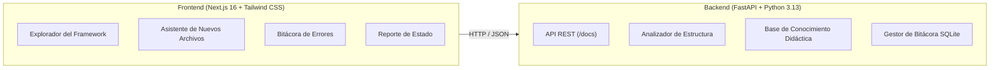

# 🎓 DevEdu Shell — Asistente de Proyecto IA

Plataforma didáctica y asistente basado en IA para estudiantes de **Ingeniería de Sistemas**. Ayuda a comprender la organización de proyectos con frameworks (Spring Boot, Laravel, Django), documentar errores en bitácora y ubicar archivos según convenciones de ingeniería de software sin compilar código en vivo.

---

## 🚀 Arquitectura General



---

## 🌟 Funcionalidades Implementadas (Sprint 1)

1. **Explorador del Framework (`/explorador`):**
   - Árbol interactivo del proyecto con detección de capas (`controllers`, `models`, `repositories`, `services`, `config`).
   - Identificación visual de archivos y carpetas fuera de convención (`TempQueryHelper.java`, `mis_scripts/`).
   - Panel dinámico con explicaciones en lenguaje simple, flujo de responsabilidades, convenciones y anotaciones clave (`@Entity`, `@RestController`, `@Service`, `@Id`).

2. **Asistente de Nuevos Archivos (`/asistente`):**
   - Interfaz conversacional donde el estudiante describe qué quiere crear (ej: *"Una pantalla para listar empleados"* o *"Autenticación JWT"*).
   - Sugerencia precisa de archivo principal, ruta absoluta en el paquete, anotación correspondiente y convención PascalCase.
   - Recomendación de archivos complementarios (Service + Repository) y checklist mental en 3 pasos antes de programar.

3. **Bitácora de Errores y Aprendizaje (`/bitacora`):**
   - Registro estructurado de incidencias durante el desarrollo en equipo.
   - Campos guiados: **Síntoma Visible**, **Causa Raíz** y **Solución Aplicada**.
   - Filtros instantáneos por categoría (`Database`, `Routing`, `Views`, `Security`) y barra de búsqueda en tiempo real.
   - Modal interactivo para documentar nuevos fallos superados.

4. **Reporte de Estado del Proyecto (`/reporte`):**
   - Diagnóstico automático para entrega de avances al docente.
   - Diagrama de las 4 capas arquitectónicas desacopladas con conectores y conteo de endpoints/servicios.
   - Indicador de Salud Arquitectónica (88%), auditoría de hallazgos para reubicación y hash criptográfico de verificación.
   - Botón para simular exportación a PDF para el profesor y compartir enlace.

---

## 💻 Instrucciones para Ejecutar

### 1. Iniciar el Backend (FastAPI)
```bash
# Desde la raíz del proyecto
cd backend
python -m uvicorn app.main:app --reload --port 8000
```
- **Documentación Swagger interactiva:** [http://localhost:8000/docs](http://localhost:8000/docs)
- **API Root:** [http://localhost:8000](http://localhost:8000)

### 2. Iniciar el Frontend (Next.js)
```bash
# En otra terminal, desde la raíz del proyecto
cd frontend
npm run dev
```
- **Aplicación web:** [http://localhost:3000](http://localhost:3000)

---

## 🎨 Tema Visual: Neon Tokyo (Retro-Futurismo)
- **Primary:** Hot Pink Neón (`#ff2d78`) — Botones principales, estados activos y badges destacados.
- **Secondary:** Neón Cyan / Mint (`#00ffcc` / `#00f0ff`) — Indicadores de validación, enlaces y métricas.
- **Tertiary:** Neón Gold (`#ffe04a`) — Advertencias y archivos fuera de convención.
- **Background:** Dark Space (`#0a0a12`).
- **Tipografías:** Sora (Títulos), Inter (Cuerpo), Space Grotesk (Etiquetas) y JetBrains Mono (Código).
